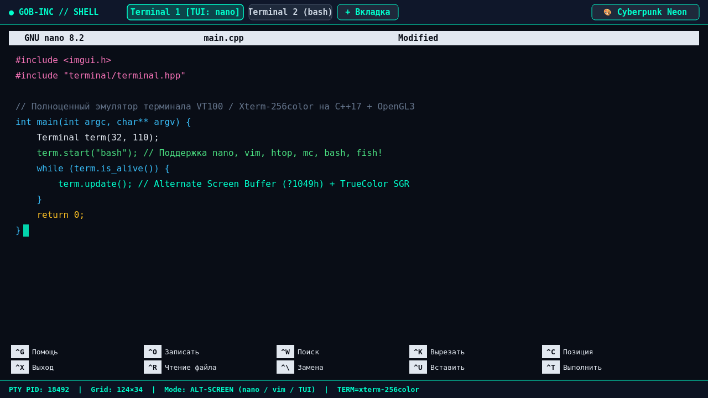

<div align="center">

🌐 **Language:** **English** | [Русский (README_Ru.md)](README_Ru.md)

# 🖥️ Gob-Inc-shell (`v2.0`)

**Full-featured GPU-accelerated graphical terminal emulator written in C++17, OpenGL 3, and Dear ImGui — supporting interactive TUI apps (`nano`, `vim`, `htop`, `mc`), tabs, and 4 color themes**

[](https://isocpp.org/)
[](https://github.com/ocornut/imgui)
[](#)
[](https://github.com/Goblin-Inc/Gob-Inc-shell/releases)

<br/>



</div>

---

## 📖 Overview

**Gob-Inc-shell v2.0** is a custom GPU-accelerated Linux terminal emulator written from scratch in **C++17**, **GLFW + OpenGL 3**, and **Dear ImGui** on top of the **POSIX PTY (`forkpty` / `TIOCSWINSZ`)** subsystem.

In version `v2.0`, the emulator evolved from a basic line-buffered console into a full **2D character cell matrix (`Cell Grid`)** with a complete **VT100 / ANSI / Xterm-256color / TrueColor (24-bit RGB)** escape-sequence state machine and **Alternate Screen Buffer (`\x1b[?1049h`)** support. Fullscreen TUI editors and utilities — including **`nano`**, **`vim` / `nvim`**, **`htop` / `btop`**, **`mc` (Midnight Commander)**, **`less`**, **`man`**, and **`bash` / `zsh` / `fish`** — run natively inside **Gob-Inc-shell**.

### ✨ Key Features in v2.0
- **Full Support for `nano`, `vim`, `htop`, `mc`**:
  - Implements the **Alternate Screen Buffer** (`?1049h` / `?1049l`, `?47h` / `?47l`, `?1047h` / `?1047l`) — exiting `nano` or `vim` immediately restores the main scrollback buffer.
  - Full support for cursor addressing (`H`, `f`, `A`–`G`, `d`), region erasing (`J`, `K`, `X`), line/character insertion & deletion (`L`, `M`, `@`, `P`, `S`, `T`), **`DECSTBM` scrolling regions (`\x1b[top;bottomr`)**, and reverse index (`\x1bM`).
  - Supports **DEC Special Graphics (`\x1b(0`)** box-drawing characters and full **UTF-8** (Cyrillic, symbols, block elements).
- **Dynamic Window & Font Resizing (`TIOCSWINSZ` + `SIGWINCH`)**:
  - Resizing the window or scaling the font automatically recalculates the `cols × rows` grid and notifies the child process via `ioctl(master_fd, TIOCSWINSZ)`, allowing `vim`, `nano`, and `htop` to reflow immediately.
- **Direct Keyboard Passthrough to PTY**:
  - Accurately forwards all control combinations `Ctrl+A` … `Ctrl+Z` (including `Ctrl+O` and `Ctrl+X` in `nano`, `Ctrl+C` for `SIGINT`, `Ctrl+Z` for `SIGTSTP`, `Ctrl+D` for `EOF`).
  - Supports Application Cursor Keys mode **DECCKM (`?1h`)**, function keys `F1`–`F12`, `Home`, `End`, `PgUp`, `PgDn`, `Insert`, `Delete`, `Tab` (shell autocompletion), and `Esc`.
- **Multi-Tab Interface & 4 Built-in Themes**:
  - Independent tabs running separate shell sessions (`+ New Tab` or `Ctrl+Shift+T`).
  - 4 built-in color palettes: **Cyberpunk Neon**, **Tokyo Night**, **Matrix Phosphor**, and **Catppuccin Mocha**.
  - Live status bar displaying active screen buffer mode (`ALT SCREEN (nano/vim/tui)` vs `NORMAL BUFFER`), encoding, and grid dimensions.

---

## ⌨️ Keyboard Shortcuts

| Shortcut | Action |
|---|---|
| `Ctrl + Shift + T` | Open a new terminal tab with an independent PTY session |
| `Ctrl + Shift + C` | Copy visible terminal screen to the system clipboard |
| `Ctrl + Shift + V` | Paste text from the system clipboard into the terminal |
| `Ctrl + Mouse Wheel` / `Font` Slider | Dynamically scale font size (`75%` – `180%`) and recalculate `cols × rows` |
| `Ctrl + O`, `Ctrl + X`, `Ctrl + W` | Standard shortcuts inside **`nano`** (Save, Exit, Search) |
| `Esc`, `:wq`, `i`, `v`, `Ctrl + R` | Standard commands and modes inside **`vim` / `nvim`** |
| `Ctrl + C` / `Ctrl + D` / `Ctrl + Z` | Process control signals (`SIGINT`, `EOF`, `SIGTSTP`) |

---

## 🏗️ Project Architecture

```
Gob-Inc-shell/
├── main.cpp                 # GLFW + OpenGL3 loop, ImDrawList cell grid renderer, tabs, and themes
├── terminal/
│   ├── terminal.hpp         # Cell, ScreenGrid, color palette structures, and VT100/Xterm parser state
│   └── terminal.cpp         # Complete CSI/OSC/ESC state machine, 256-color/TrueColor, Alternate Screen, UTF-8
├── process/
│   ├── pty.hpp              # POSIX pseudo-terminal interface
│   └── pty.cpp              # forkpty(), non-blocking I/O, TERM=xterm-256color, ioctl(TIOCSWINSZ)
└── third_party/imgui/       # Bundled Dear ImGui engine (OpenGL3 + GLFW backend)
```

---

## 📦 Installation & Build

### Option 1: Install from `.deb` package (Ubuntu / Debian / KDE Neon)
Download `gob-inc-shell_2.0.0_amd64.deb` from [**Releases**](https://github.com/Goblin-Inc/Gob-Inc-shell/releases):

```bash
sudo dpkg -i gob-inc-shell_2.0.0_amd64.deb
sudo apt-get install -f
```
Launch **Gob-Inc-shell** from your application launcher or by running `gob-inc-shell`.

### Option 2: Build & Run on Arch Linux (`pacman`) or Debian/Ubuntu (`apt`)
```bash
# On Arch Linux:
sudo pacman -S base-devel glfw mesa

# On Ubuntu / Debian:
sudo apt install build-essential libglfw3-dev libgl1-mesa-dev

git clone https://github.com/Goblin-Inc/Gob-Inc-shell.git
cd Gob-Inc-shell
mkdir -p build
g++ -std=c++17 -O2 -pthread \
    main.cpp process/pty.cpp terminal/terminal.cpp \
    third_party/imgui/imgui.cpp third_party/imgui/imgui_draw.cpp \
    third_party/imgui/imgui_tables.cpp third_party/imgui/imgui_widgets.cpp \
    third_party/imgui/backends/imgui_impl_glfw.cpp \
    third_party/imgui/backends/imgui_impl_opengl3.cpp \
    -I. -Ithird_party/imgui -Ithird_party/imgui/backends \
    -lglfw -lGL -ldl -lutil -o build/myshell_gui
./build/myshell_gui
```

---

## 📋 Changelog

### `v2.0.0` — Complete VT100/Xterm Core Rewrite, `nano`/`vim` Support & New UI *(Current)*
- **Added**: 2D cell buffer (`ScreenGrid`) with **Alternate Screen Buffer (`?1049h`/`?1049l`)** support for `nano`, `vim`, `htop`, `mc`, and `less`.
- **Added**: Full CSI/OSC/ESC escape sequence parser including `DECSTBM` scroll regions, `Xterm-256color`, `24-bit TrueColor`, and `DEC Special Graphics`.
- **Added**: Direct keyboard capture supporting `Ctrl+A..Z`, `F1..F12`, arrow keys (`DECCKM`), `Tab`, and clipboard (`Ctrl+Shift+C` / `Ctrl+Shift+V`).
- **Added**: Dynamic `ioctl(TIOCSWINSZ)` resize signaling when changing window size or font scale.
- **Added**: Multi-tab bar (`+ New Tab`), status bar, and 4 color themes (**Cyberpunk Neon**, **Tokyo Night**, **Matrix Phosphor**, **Catppuccin Mocha**).

### `v1.0.0` — Initial Prototype
- Basic `bash` spawning via `forkpty` with a single-line input box (`InputText`).

---

<div align="center">
Developed by <a href="https://github.com/Goblin-Inc">@Goblin-Inc</a> • <a href="README_Ru.md">Русская версия</a>
</div>
