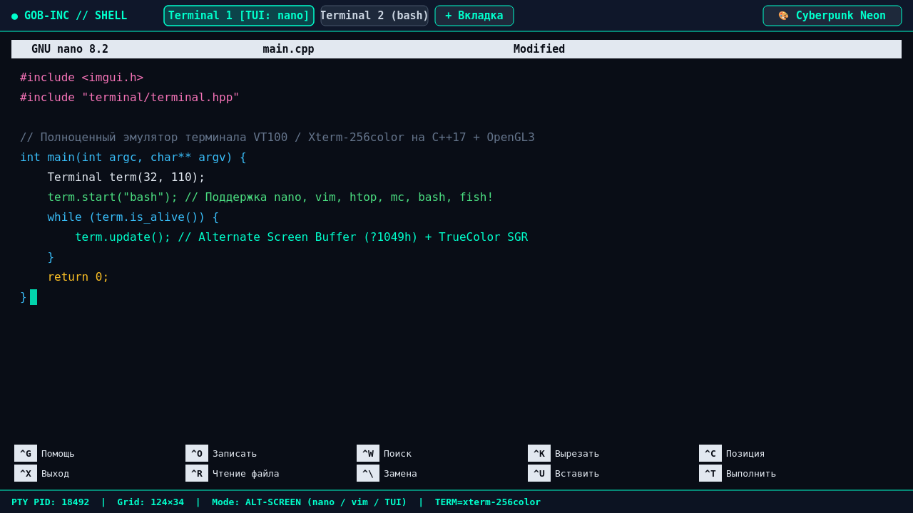

<div align="center">

🌐 **Язык:** [English (README.md)](README.md) | **Русский**

# 🖥️ Gob-Inc-shell (`v2.0`)

**Полнофункциональный графический эмулятор терминала на C++17, OpenGL 3 и Dear ImGui с поддержкой интерактивных TUI-приложений (`nano`, `vim`, `htop`, `mc`), вкладок и 4 цветовых тем**

[](https://isocpp.org/)
[](https://github.com/ocornut/imgui)
[](#)
[](https://github.com/Goblin-Inc/Gob-Inc-shell/releases)

<br/>



</div>

---

## 📖 О проекте

**Gob-Inc-shell v2.0** — кастомный GPU-ускоренный эмулятор терминала для Linux, написанный с нуля на **C++17**, **GLFW + OpenGL 3** и **Dear ImGui** поверх системного псевдотерминала **POSIX PTY (`forkpty` / `TIOCSWINSZ`)**.

Во второй версии (`v2.0`) терминал перешёл от простой построчной консоли к полноценной **клеточной матрице экрана (`Cell Grid`)** с полным парсером управляющих последовательностей **VT100 / ANSI / Xterm-256color / TrueColor (24-bit RGB)** и поддержкой **Alternate Screen Buffer (`\x1b[?1049h`)**. Благодаря этому внутри **Gob-Inc-shell** безупречно работают полноэкранные консольные редакторы и утилиты: **`nano`**, **`vim` / `nvim`**, **`htop` / `btop`**, **`mc` (Midnight Commander)**, **`less`**, **`man`**, **`bash` / `zsh` / `fish`**.

### ✨ Ключевые возможности v2.0
- **Полноценная работа с `nano`, `vim`, `htop`, `mc`**:
  - Реализован **Alternate Screen Buffer** (`?1049h` / `?1049l`, `?47h` / `?47l`, `?1047h` / `?1047l`) — при выходе из `nano` или `vim` основной буфер истории терминала мгновенно восстанавливается.
  - Полная поддержка позиционирования курсора (`H`, `f`, `A`–`G`, `d`), очистки регионов (`J`, `K`, `X`), вставки/удаления строк и символов (`L`, `M`, `@`, `P`, `S`, `T`), регионов прокрутки **`DECSTBM` (`\x1b[top;bottomr`)** и обратного индекса (`\x1bM`).
  - Поддержка псевдографики рамок **DEC Special Graphics (`\x1b(0`)** и полного **UTF-8** (кириллица, спецсимволы, блочные элементы).
- **Динамический ресайз окна (`TIOCSWINSZ` + `SIGWINCH`)**:
  - При изменении размера окна или масштаба шрифта терминал автоматически пересчитывает число колонок и строк (`cols × rows`) и уведомляет запущенный процесс через `ioctl(master_fd, TIOCSWINSZ)`, чтобы `vim`, `nano` и `htop` мгновенно перестраивали свою сетку.
- **Прямая проброска клавиатуры в PTY**:
  - Честная передача всех управляющих комбинаций `Ctrl+A` … `Ctrl+Z` (включая `Ctrl+O` и `Ctrl+X` для сохранения/выхода в `nano`, `Ctrl+C` для `SIGINT`, `Ctrl+Z` для `SIGTSTP`, `Ctrl+D` для `EOF`).
  - Поддержка режима курсорных клавиш приложения **DECCKM (`?1h`)**, функциональных клавиш `F1`–`F12`, `Home`, `End`, `PgUp`, `PgDn`, `Insert`, `Delete`, `Tab` (автодополнение bash/zsh) и `Esc`.
- **Мульти-вкладки и 4 визуальные темы**:
  - Независимые вкладки с собственными процессами `bash` (`+ Новая вкладка` или `Ctrl+Shift+T`).
  - 4 встроенные темы: **Cyberpunk Neon**, **Tokyo Night**, **Matrix Phosphor**, **Catppuccin Mocha**.
  - Информационный статус-бар с индикацией режима экрана (`ALT SCREEN (nano/vim/tui)` vs `NORMAL BUFFER`), кодировки и размера сетки.

---

## ⌨️ Горячие клавиши

| Сочетание клавиш | Действие |
|---|---|
| `Ctrl + Shift + T` | Открыть новую вкладку терминала с независимой PTY-сессией |
| `Ctrl + Shift + C` | Скопировать видимый экран терминала в системный буфер обмена |
| `Ctrl + Shift + V` | Вставить текст из системного буфера обмена в терминал |
| `Ctrl + Колесо мыши` / Слайдер `Шрифт` | Динамическое масштабирование шрифта (`75%` – `180%`) с пересчётом сетки `cols × rows` |
| `Ctrl + O`, `Ctrl + X`, `Ctrl + W` | Штатные хоткеи внутри **`nano`** (Сохранить, Выйти, Поиск) |
| `Esc`, `:wq`, `i`, `v`, `Ctrl + R` | Штатные команды и режимы внутри **`vim` / `nvim`** |
| `Ctrl + C` / `Ctrl + D` / `Ctrl + Z` | Сигналы управления процессом (`SIGINT`, `EOF`, `SIGTSTP`) |

---

## 🏗️ Архитектура проекта

```
Gob-Inc-shell/
├── main.cpp                 # Оконный цикл GLFW + OpenGL3, рендеринг клеточной сетки ImDrawList, вкладки и темы
├── terminal/
│   ├── terminal.hpp         # Структуры Cell, ScreenGrid, цветовых палитр и парсера VT100/Xterm
│   └── terminal.cpp         # Полный автомат разбора CSI/OSC/ESC, 256-color/TrueColor, Alternate Screen и UTF-8
├── process/
│   ├── pty.hpp              # Интерфейс POSIX псевдотерминала
│   └── pty.cpp              # forkpty(), неблокирующий ввод/вывод, TERM=xterm-256color, ioctl(TIOCSWINSZ)
└── third_party/imgui/       # Встроенный движок Dear ImGui (OpenGL3 + GLFW backend)
```

---

## 📦 Установка и сборка

### Вариант 1: Установка из `.deb` пакета (Ubuntu / Debian / KDE Neon)
Скачайте `gob-inc-shell_2.0.0_amd64.deb` из раздела [**Releases**](https://github.com/Goblin-Inc/Gob-Inc-shell/releases):

```bash
sudo dpkg -i gob-inc-shell_2.0.0_amd64.deb
sudo apt-get install -f
```
После установки запустите **Gob-Inc-shell** из меню приложений или командой `gob-inc-shell`.

### Вариант 2: Сборка и запуск на Arch Linux (`pacman`) или Debian/Ubuntu (`apt`)
```bash
# На Arch Linux:
sudo pacman -S base-devel glfw mesa

# На Ubuntu / Debian:
sudo apt install build-essential libglfw3-dev libgl1-mesa-dev
git clone https://github.com/Goblin-Inc/Gob-Inc-shell.git
cd Gob-Inc-shell
mkdir -p build
g++ -std=c++17 -O2 -pthread \
    main.cpp process/pty.cpp terminal/terminal.cpp \
    third_party/imgui/imgui.cpp third_party/imgui/imgui_draw.cpp \
    third_party/imgui/imgui_tables.cpp third_party/imgui/imgui_widgets.cpp \
    third_party/imgui/backends/imgui_impl_glfw.cpp \
    third_party/imgui/backends/imgui_impl_opengl3.cpp \
    -I. -Ithird_party/imgui -Ithird_party/imgui/backends \
    -lglfw -lGL -ldl -lutil -o build/myshell_gui
./build/myshell_gui
```

---

## 📋 Changelog

### `v2.0.0` — Полная переработка ядра VT100/Xterm, поддержка `nano`/`vim` и новый дизайн *(Текущая версия)*
- **Добавлено**: Клеточный экранный буфер (`ScreenGrid`) с поддержкой **Alternate Screen Buffer (`?1049h`/`?1049l`)** для работы `nano`, `vim`, `htop`, `mc`, `less`.
- **Добавлено**: Полный парсер управляющих последовательностей CSI/OSC/ESC, включая `DECSTBM` регионы прокрутки, `Xterm-256color`, `24-bit TrueColor` и `DEC Special Graphics`.
- **Добавлено**: Прямой перехват клавиатуры с поддержкой `Ctrl+A..Z`, `F1..F12`, стрелок (`DECCKM`), `Tab` и буфера обмена (`Ctrl+Shift+C` / `Ctrl+Shift+V`).
- **Добавлено**: Динамический `ioctl(TIOCSWINSZ)` при изменении размера окна и масштаба шрифта.
- **Добавлено**: Новый современный интерфейс с вкладками (`+ Новая вкладка`), статус-баром и 4 цветовыми темами (**Cyberpunk Neon**, **Tokyo Night**, **Matrix Phosphor**, **Catppuccin Mocha**).

### `v1.0.0` — Первоначальный прототип
- Базовый запуск `bash` через `forkpty` с построчным текстовым полем ввода (`InputText`).

---

<div align="center">
Разработано <a href="https://github.com/Goblin-Inc">@Goblin-Inc</a>
</div>
